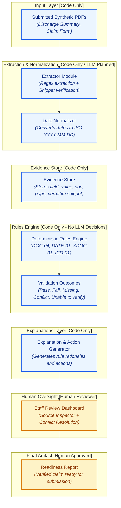

# ClaimPilot Prototype

> **SYNTHETIC DEMONSTRATION DATA - NOT A REAL PATIENT RECORD**

*The agent drafts, code verifies, every field traces to its source, and the human approves.*

ClaimPilot is an AI-assisted, deterministically verified health insurance pre-submission validation system designed to catch documentation gaps and discrepancies before claims are submitted to insurers. The system extracts clinical and billing entities with strict provenance (document name, page number, and verbatim snippet), enforces deterministic Python-based compliance rules across five rigid validation states, flags cross-document discrepancies for staff reconciliation, and provides an interactive source document inspector for instant human verification.

---

## Prototype Status Matrix

| Working (Runs Right Now) | Simulated (Synthetic or Mocked) | Planned (Future Production Scope) |
| :--- | :--- | :--- |
| • **Regex-based extraction** with exact page number and verbatim snippet retention | • **Synthetic documents**: Fictional patient "Ravi Kumar", hospital, and policy records | • **LLM-assisted extraction** with bounded fallback retries |
| • **Date normalizer** resolving multi-format dates (`05/03/2026` = `5 March 2026`) | • **Simulated rules**: 4 demo rules (`DOC-04`, `DATE-01`, `XDOC-01`, `ICD-01`) marked `rule_status="simulated"` (none are official-verified) | • **True PDF rendering & visual canvas highlighting** (react-pdf) |
| • **Four deterministic rules** executing in pure Python (LLM never decides compliance) | • **Sample ICD-10 list**: Small reference table (`~20` codes), not full ICD-10 catalog | • **OCR pipeline** for scanned and handwritten claims |
| • **Strict 5-state validation engine**: `Pass`, `Fail`, `Missing`, `Conflict`, `Unable to verify` | • **Regex standing in for LLM**: Handcrafted regex extractor tuned to prototype documents | • **Staff correction & approval gate** with audit trail |
| • **FastAPI backend** (`POST /analyze`, `GET /documents/{name}/pages/{n}`) | | • **Full claim packet PDF generation** |
| • **Futuristic Cinematic Web Experience** (Top horizontal navigation, custom animated mega-dropdowns, procedural Three.js 3D medical AI visual, equalizer wave loading sequence, zero sidebar/dashboard) | | • **Official-verified insurer rulebook** with cited clause references |
| • **Interactive Source Inspector** with dynamic verbatim text snippet highlighting | | • **20-case clinical evaluation benchmark** |
| • **Pytest test suite** (11 unit and API validation tests, 100% passing) | | |

---

## Architecture

The following diagram illustrates ClaimPilot's pre-submission validation pipeline, explicitly marking which components are driven by code, AI, or human oversight:



---

## Quickstart & Run Steps (Windows)

### Prerequisites
- Python 3.10+ (tested on Python 3.14.4)
- Node.js v18+ and npm (tested on Node v20.20.2, npm 10.8.2)

### 1. Setup Backend
Open a terminal in the project root (`ClaimPailot/`):

```powershell
# Install backend dependencies
python -m pip install -r requirements.txt

# Run pytest suite to verify all rules and endpoints
python -m pytest -v

# Start FastAPI server
python -m uvicorn backend.main:app --host 127.0.0.1 --port 8000 --reload
```
* Backend Health Check: [http://127.0.0.1:8000/](http://127.0.0.1:8000/)
* Interactive Swagger Docs: [http://127.0.0.1:8000/docs](http://127.0.0.1:8000/docs)

### 2. Setup & Start Frontend
Open a second terminal:

```powershell
# Navigate to frontend folder
cd frontend

# Install frontend dependencies (if not already installed)
npm install

# Start Vite React development server
npm run dev
```

### 3. Open Application
Navigate to:
👉 **[http://127.0.0.1:5173/](http://127.0.0.1:5173/)**

---

## How to Read the Demo

The demonstration pre-loads two synthetic PDF documents (`discharge_summary.pdf` and `claim_form.pdf`) containing deliberate edge cases to showcase deterministic verification:

1. **The `Missing` Rule Card (`DOC-04`)**:
   - **What it shows**: The rule engine strictly checks for required document types. Because no admission note was uploaded in the packet, `DOC-04` flags `Missing` with action: *"Upload the admission note and rerun validation."* Missing data is never coerced into a `Pass`.
2. **The `Conflict` Card (`XDOC-01`)**:
   - **What it shows**: The discharge date in `discharge_summary.pdf` is `08 March 2026` (Page 1), while `claim_form.pdf` claims `09 March 2026` (Page 1). The system isolates this cross-document disagreement into a high-visibility card displaying both documents, their page citations, and values side-by-side for human reconciliation.
3. **The Source Inspector (Right Panel)**:
   - **What it shows**: Click any row in the **Extracted Fields** table. The Source Inspector immediately fetches that page's text from the backend and highlights the exact verbatim snippet using ambient yellow highlighting. Every field must have a proven snippet; fields lacking verifiable snippets are rejected at extraction time.

---

## Limitations

- **Single Scheme & Procedure**: Tuned specifically for uncomplicated acute appendicitis / laparoscopic appendectomy claims under standard indemnity terms.
- **Synthetic Demonstration Data Only**: All records, hospital names, doctor registrations, and patient IDs are fictional.
- **Simulated Rules**: Rules are illustrative hackathon models (`rule_status="simulated"`) and have not undergone clinical, legal, or official insurer review.
- **Extractor Constraints**: The current regex extractor is built for structured text and has not been tested against noisy, scanned, handwritten, or OCR-processed documents.
- **Decision Boundary**: ClaimPilot does not predict or guarantee insurer authorization decisions; it strictly evaluates internal documentary consistency and prerequisite completeness.

---

## Screenshots

*(Placeholder links for submission visuals)*

### 1. Full Dashboard Overview

*Complete screen showing synthetic data banner, extracted fields table, deterministic rule results, and cross-document conflict card.*

### 2. Interactive Source Snippet Highlight

*Field clicked on the table with corresponding verbatim text snippet highlighted in the page text inspector.*

### 3. Missing Admission Note Card & Action

*Rule DOC-04 displaying Missing state with recommended staff remediation action.*

### 4. Passing Pytest Verification Suite

*Terminal showing 11/11 passing tests across date normalization, rules engine states, and API endpoints.*
